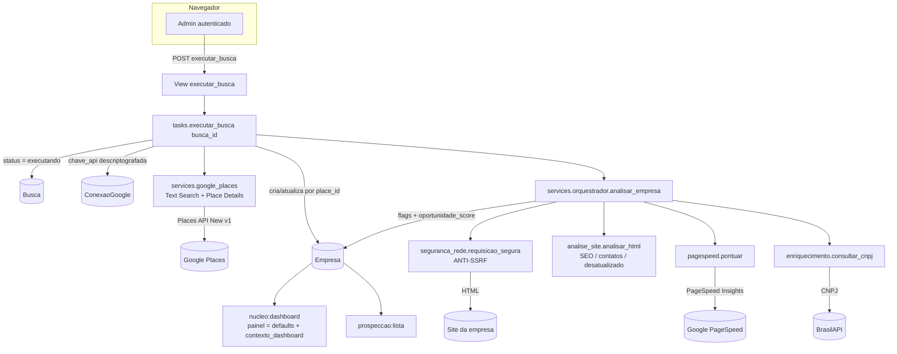
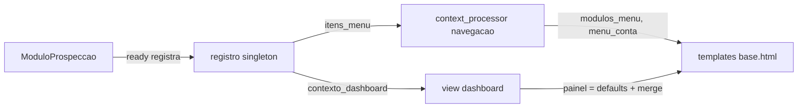

# Arquitetura do modulos

Este documento explica **como o modulos é organizado** e **por que**: a base
modular, o registro de módulos, o context processor de navegação, o contrato do
`painel` (dashboard) e o fluxo de uma busca até virar `Empresa`.

A fonte única de verdade dos nomes e contratos é [SPEC.md](SPEC.md). Aqui o foco
é a visão de conjunto.

---

## 1. Visão geral: uma BASE + módulos

O sistema é dividido em três apps Django, todos sob o pacote `apps/`:

| App              | Papel                                                                 |
|------------------|-----------------------------------------------------------------------|
| `apps.contas`    | Autenticação (login por e-mail, **somente admin**), throttling, auditoria de login. |
| `apps.nucleo`    | A **BASE**: dashboard, registro de módulos, navegação, criptografia, cabeçalhos de segurança, auditoria. |
| `apps.prospeccao`| O **1º módulo** plugável: encontra e qualifica empresas.              |

A ideia central é a **inversão de dependência**:

> O `nucleo` **nunca** importa os módulos. São os módulos que se **anunciam** ao
> núcleo, no `ready()` do seu `AppConfig`.

Assim, adicionar um módulo novo (ex.: "Relatórios", "Campanhas") **não exige
alterar o núcleo**. Basta criar o app, registrar o módulo e ele aparece no menu
e no dashboard. O passo a passo está em [COMO_CRIAR_MODULOS.md](COMO_CRIAR_MODULOS.md).

```
config/                 # projeto Django (settings, urls, wsgi, asgi)
apps/
  contas/               # autenticação (somente admin)
  nucleo/               # BASE: dashboard + registro de módulos
  prospeccao/           # módulo 1: prospecção
templates/              # base.html + telas
static/                 # css/js locais (sem CDN, por causa da CSP)
docs/                   # esta documentação + SPEC.md
```

---

## 2. O registro de módulos (`apps/nucleo/modulos.py`)

É o **coração da base**. Define dois objetos e um singleton:

### `ModuloBase`

Classe que cada módulo estende para se descrever. Atributos de classe:

- `slug: str` — identificador único (ex.: `"prospeccao"`).
- `nome: str` — rótulo no menu (ex.: `"Prospecção"`).
- `icone: str` — chave de ícone da sidebar (ver seção 5 da SPEC).
- `ordem: int = 100` — peso de ordenação (menor aparece primeiro).
- `descricao: str = ""` — texto curto opcional.

Métodos (todos com implementação padrão, sobrescreva o que precisar):

- `url_inicial(self) -> str` — o *name* de URL do item principal (padrão `"#"`).
- `itens_menu(self, request) -> list[dict]` — os `ItemMenu` que o módulo põe na
  sidebar (padrão: um item apontando para `url_inicial()`).
- `contexto_dashboard(self, request) -> dict` — dados que o módulo injeta no
  painel (padrão `{}`).

### `RegistroModulos` e o singleton `registro`

`registro` é a **única** instância usada por todo o sistema:

- `registrar(classe_modulo)` — registra a classe (amigável a decorator; retorna
  a própria classe). Idempotente: re-registrar o mesmo `slug` substitui.
- `todos()` — módulos ordenados por `ordem`, depois por `nome`.
- `itens_menu(request)` — concatena os itens de menu de todos os módulos.
- `contexto_dashboard(request)` — faz o **merge raso** dos dicts de todos os
  módulos (a ordem canônica define a precedência).

Ambos `itens_menu` e `contexto_dashboard` são **resilientes**: a falha de um
módulo é registrada no log e ignorada, sem derrubar o menu nem o dashboard.

### Descoberta (o `ready()`)

Cada app-módulo importa seu `modulo.py` no `ready()` do `AppConfig`. Exemplo real
(`apps/prospeccao/apps.py`):

```python
class ProspeccaoConfig(AppConfig):
    name = "apps.prospeccao"
    def ready(self) -> None:
        from apps.prospeccao import modulo  # noqa: F401  (efeito: registro)
```

E o `apps/prospeccao/modulo.py` faz o registro via decorator:

```python
@registro.registrar
class ModuloProspeccao(ModuloBase):
    slug = "prospeccao"
    nome = "Prospecção"
    icone = "prospeccao"
    ordem = 10
    ...
```

---

## 3. O context processor de navegação (`apps/nucleo/context_processors.py`)

A função `navegacao(request)` está registrada em
`TEMPLATES → OPTIONS → context_processors` (ver `config/settings.py`) e injeta em
**todos** os templates as quatro chaves do contrato (seção 5 da SPEC):

```python
{
  "site_nome": "Gerenciador de Módulos",
  "modulos_menu": [ItemMenu, ...],   # via registro.itens_menu(request)
  "menu_conta": [ItemMenu, ...],     # Perfil, Configurações, Sair
  "rota_atual": "nucleo:dashboard",  # view_name atual (ou "")
}
```

Cada `ItemMenu` é um dict com chaves **exatas**:
`{"rotulo": str, "url": str, "icone": str, "ativo": bool}`.

Se algo falhar aqui, a função devolve defaults seguros (menus vazios) para nunca
quebrar a renderização.

---

## 4. O contrato do `painel` (dashboard)

A view `nucleo:dashboard` (`apps/nucleo/views.py`) monta o dicionário `painel`
em duas etapas:

1. **Defaults zerados** para **todas** as chaves da seção 7 da SPEC (via
   `_painel_padrao()`). Isso garante que o dashboard renderiza mesmo **sem
   nenhum módulo** instalado.
2. **Merge** com o que os módulos fornecem via
   `registro.contexto_dashboard(request)`.

O `painel` alimenta os 6 cards do dashboard:

| Card | Chaves principais |
|------|-------------------|
| 1 — Resumo de Prospecção (linha) | `total_empresas`, `novas_semana`, `variacao_pct`, `serie_encontradas`, `serie_qualificadas` |
| 2 — Oportunidades (donut)        | `oportunidades_total`, `oportunidades` (`{rotulo, pct, cor}`) |
| 3 — Próximas ações               | `proximas_acoes` (`{quando, titulo, tag}`) |
| 4 — Empresas encontradas (tabela)| `empresas` (lista de **`EmpresaLinha`**) |
| 5 — Meta de prospecção           | `meta_atual`, `meta_total`, `meta_pct` |
| 6 — Destaques                    | `destaque_titulo`, `destaque_texto` |

O **`prospeccao`** preenche essas chaves com dados reais em
`ModuloProspeccao.contexto_dashboard` (queries agregadas eficientes). Qualquer
exceção ali resulta em `{}`, deixando o núcleo aplicar os defaults zerados.

### `EmpresaLinha` (a regra do cliente)

Cada linha da tabela principal (e da lista) é um dict produzido por
`Empresa.linha_dashboard()` com as chaves **exatas**:

```
nome, tempo_mercado, responsavel, email, instagram, dominio, whatsapp,
problemas (list[str]), inicial (avatar), cor (avatar), pk
```

Campos vazios viram `"—"`. Os `problemas` vêm de `Empresa.rotulos_problemas()`
(ex.: "Sem site", "SEO fraco", "Sem SSL"...).

---

## 5. Fluxo de uma busca: da tela até `Empresa`

O caminho de uma busca real (modo com chave do Google) passa por
**view → task → serviços (orquestrador) → banco**. Cada etapa é isolada e
resiliente (falha de uma etapa não derruba o todo).

1. **`nova_busca`** (`apps/prospeccao/views.py`) cria uma `Busca` com status
   `pendente` (não executa nada ainda).
2. **`executar_busca`** (POST, CSRF) chama a task síncrona
   `apps/prospeccao/tasks.py::executar_busca(busca_id)`.
3. A **task**:
   - marca a `Busca` como `executando`;
   - pega a `chave_api` **descriptografada** da `ConexaoGoogle`;
   - chama `services/google_places.py::buscar_empresas(...)` (Places Text Search);
   - para cada resultado, cria/atualiza uma `Empresa` (dedup por `place_id`);
   - chama `services/orquestrador.py::analisar_empresa(empresa, conexao)`.
4. O **orquestrador** encadeia:
   - Place Details (completa website/telefone ausentes);
   - **download seguro** do site via `seguranca_rede.py::requisicao_segura`
     (**anti-SSRF** — nunca `requests` direto para o site de terceiro);
   - `analise_site.py::analisar_html` (título/description/H1, SEO, "só
     Instagram", desatualização, extrai e-mail/Instagram/WhatsApp/domínio);
   - `pagespeed.py::pontuar` (nota de performance; `None` sem chave);
   - `enriquecimento.py` (CNPJ via BrasilAPI → fundação, tempo de mercado,
     responsável);
   - calcula flags e `oportunidade_score` e **salva** a `Empresa`.
5. A task grava `total_resultados` e o status final (`concluida`/`erro`).
6. O **dashboard** e a **lista** leem as `Empresa` do banco e as exibem via
   `linha_dashboard()`.

> A task é síncrona, porém **isolada e sem dependência de request** — pronta
> para virar uma task Celery apenas decorando-a (a estrutura está em `tasks.py`).

### Diagrama (Mermaid)



### Como o dashboard se monta (Mermaid)



---

## 6. Camadas transversais (segurança e infra)

- **Somente admin:** `apps.contas.middleware.SomenteAdminMiddleware` exige
  `is_authenticated + is_staff` em todas as rotas exceto login/logout/admin/
  estáticos. CBVs usam `AdminRequeridoMixin`; FBVs usam `@admin_requerido`.
- **Cabeçalhos/CSP:** `apps.nucleo.middleware.CabecalhosSegurancaMiddleware`
  aplica CSP (sem CDN), `X-Content-Type-Options`, `Referrer-Policy`,
  `Permissions-Policy`.
- **Criptografia:** `apps/nucleo/criptografia.py` (`criptografar` /
  `descriptografar` com Fernet) protege as chaves de API em repouso.
- **Auditoria:** `apps/nucleo/models.py::RegistroAuditoria` (quem, ação, objeto,
  IP, quando).
- **Estáticos:** WhiteNoise serve os arquivos em produção.

Tudo isso está detalhado em [SEGURANCA.md](SEGURANCA.md).
